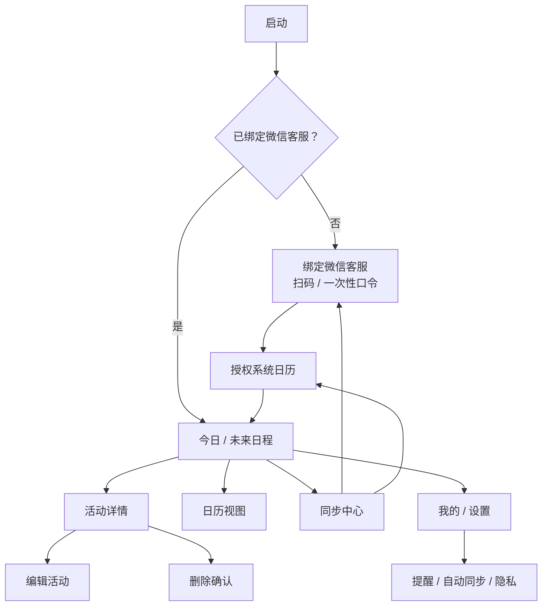
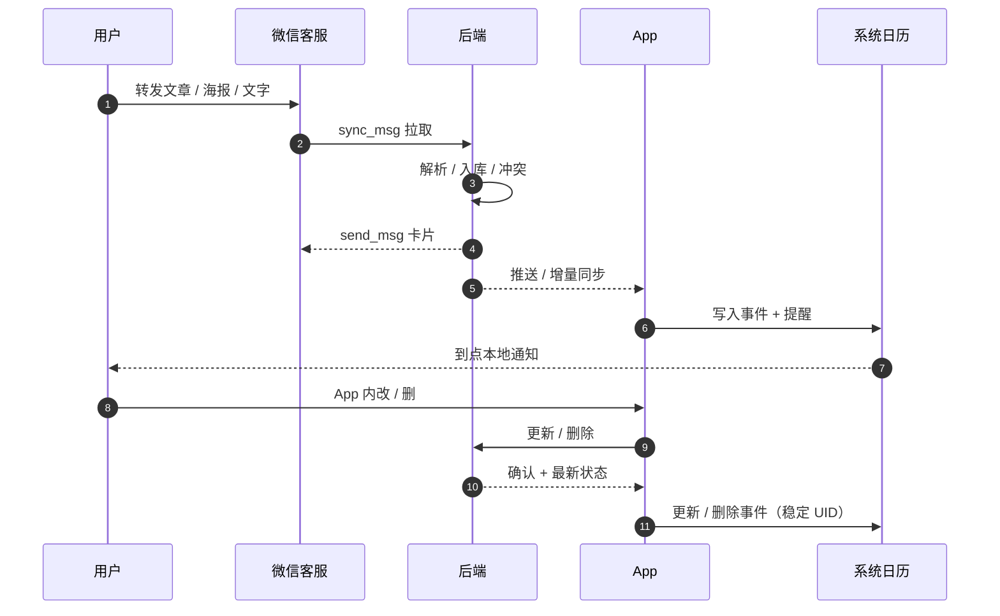

# 微信服务号日程捕获与系统日历提醒 Agent 需求文档

## 1. 文档信息与一句话定位

### 1.1 文档信息

| 项目 | 内容 |
|---|---|
| 文档名称 | 微信服务号日程捕获与系统日历提醒 Agent 需求文档 |
| 版本 | v0.4（安卓演示与 App 界面框架稿） |
| 日期 | 2026-11-25 |
| 文档性质 | 产品需求文档（PRD），以能力描述与验收标准为主，非技术设计文档 |
| 面向对象 | 48 小时黑客松团队：产品 / 后端 / 解析与 AI / 测试与演示 |
| 需求来源 | 清华校内活动信息分散于公众号推文，用户转发到「文件传输助手」后缺乏结构化整理与系统级提醒 |

**变更记录**

| 版本 | 日期 | 变更 |
|---|---|---|
| v0.1 | 2026-11-22 | 初稿：以 iPhone 为演示基线的 48 小时黑客松 PRD |
| v0.2 | 2026-11-25 | 演示基线改为 Android 13 + DAVx5；补充微信客服演示通道、图片入口与「App / 微信客服-only」两条产品演进路径 |
| v0.3 | 2026-11-25 | 补充「自研 App + 微信客服官方 API」推荐落地形态；明确 DAVx5 为演示替身，App 内可增删改，后端统一活动库 |
| v0.4 | 2026-11-25 | 新增 §15.6 App 界面与信息架构：可渲染的页面框架图、核心页面线框、核心流程与 App MVP 范围 |

### 1.2 一句话定位

用户把校内活动推文链接、海报图片或一段活动文字发给微信服务号，Agent 在 30 秒内抽取结构化日程，并在服务号对话框内提供可编号管理的清单，再通过日历同步通道写入手机系统日历，由系统日历完成下拉可见与到点弹窗提醒。

**职责边界一句话：微信服务号负责「收、管、改」，手机系统日历负责「看、提醒」。**

### 1.3 硬性约束与需求映射

以下 8 条为不可更改的产品红线，后续所有功能设计必须可回溯到对应需求编号。

| # | 硬性约束 | 对应需求 |
|---|---|---|
| 1 | 所有活动默认记录，冲突并存并标记，不得自动过滤或只保留一条 | FR-11、FR-12、FR-13、FR-14 |
| 2 | 支持一键或定时推送到手机内置系统日历，下拉可见 | FR-22、FR-23、FR-24、FR-25 |
| 3 | 记录、展示、删改全部在服务号对话框内完成，不使用小程序 | FR-15 ~ FR-21 |
| 4 | 提醒必须由手机系统生态完成，不能以微信聊天红点或订阅消息为主提醒 | FR-28、FR-29 |
| 5 | 微信内删除/修改后，同步删除/更新系统日历事件 | FR-25、FR-19、FR-18 |
| 6 | 系统日历内删除不反向同步回微信，但需定义微信侧状态 | FR-26 |
| 7 | 对话框承担展示：关键词、菜单、编号列表、详情、文本指令 | FR-15 ~ FR-21 |
| 8 | 不用小程序；不把订阅消息作为高频主提醒；不要求用户逐条手动加日历 | 全局非目标（第 4 章）、FR-28 |

> **约束 3 的范围说明**：约束 3 的「记录、展示、删改全部在对话框内完成」适用于本期演示与微信内主路径。§15 路径 A 的产品化形态允许 App 作为第二管理端；届时以 §15.2 为准，不视为违反本期约束。

### 1.4 演示基线、通道与本期边界（v0.4）

**本期演示基线**

- 主演示机：Redmi Note 11 Pro+ / Android 13；安装 DAVx5，将 CalDAV 日历写入系统日历，由系统日历发出本地提醒。
- iPhone：保留原生 CalDAV 配置路径，作为兼容性验证；本期不以 iPhone 为主演示机。
- 对话通道：演示阶段由「微信客服」承载 PRD 中的「服务号对话框」；用户在客服对话内发文字、链接、图片并接收卡片。

**通道说明**

- 微信客服网页工作台桥接只是**演示替身**：它负责在演示机上拉取客户消息并回写回复，不是生产接口，不承诺 SLA，也不具备多客服/多用户能力。
- 生产形态应接入微信客服官方 API（或认证服务号），并完成可信 IP、可信回调、权限申请；本期不实现。
- 因此，本 PRD 的交互契约（指令、卡片、编号、状态）与最终通道解耦：换通道不改变用户体验。

**图片入口**

- 本期 P0 需覆盖微信客服中的活动海报图片：接收图片 → OCR → 复用文本规则抽取 → 卡片 → 系统日历。
- 公众号测试号的图片素材下载通道列为后续；本期图片入口以客服演示通道为准。

**本期明确不做**

- 自建 App（见 §15 路径 A）。
- 微信客服-only 的正式产品裁剪（见 §15 路径 B）。
- 官方微信客服 API 权限接入、多用户隔离、正式 CalDAV 账户体系。
- 本章两条路径只用于答辩说明，不进入本期验收。

> 答辩口径以真机验收为准：未在 Android 演示机上跑通的能力，不得在答辩中声称已支持；图片 OCR、DAVx5 提醒、改删同步均需现场或录屏证据。

---

## 2. 背景、痛点与目标

### 2.1 现状流程与断点

| 环节 | 用户当前做法 | 断点 |
|---|---|---|
| 发现活动 | 刷微信公众号推文 | 信息以长文、海报图片形式存在，非结构化 |
| 暂存 | 转发到「文件传输助手」 | 只完成了「存」，没有完成「整理」；条目无标题、无时间字段 |
| 回看 | 活动多了之后向上翻找 | 无排序、无筛选、无冲突提示，查找成本随条目数上升 |
| 记忆 | 靠脑子记时间 | 无提醒，冲突不可见，临期容易遗漏 |
| 到场 | 临时回忆或放弃 | 活动错过，或两个活动撞车 |

### 2.2 三个本质问题

1. **捕获与整理分离**：转发动作很轻，但转发后的内容仍是原始文本/图片，需要人二次加工。
2. **记录与提醒分离**：微信里的记录不会主动响；真正会响的是系统日历，但用户不会逐条手动录入。
3. **冲突不可见**：同一晚多个活动在微信里只是几条并列消息，用户无法一眼看出时间重叠。

### 2.3 产品目标（可度量）

| 编号 | 目标 | 度量口径 |
|---|---|---|
| G1 | 捕获即结构化 | 文本 ≤ 30 秒、图片 ≤ 90 秒返回结构化结果；20 条自建评测集上核心字段（名称 + 开始时间）抽取准确率 ≥ 90% |
| G2 | 进入系统日历足够快 | 开启自动同步时，从发送消息到系统日历可见 ≤ 10 分钟 |
| G3 | 微信内管理足够轻 | 完成一次查看 / 修改 / 删除 ≤ 2 条用户消息（不含二次确认） |
| G4 | 冲突零丢失 | 冲突活动 100% 并存记录、并存同步、并存提醒；自动丢弃条数 = 0 |
| G5 | 提醒不依赖微信 | 100% 的到点提醒由系统日历本地通知发出；关闭微信通知后仍可提醒 |

### 2.4 成功判据（黑客松范围）

- 演示现场用一台 Android 手机（Redmi Note 11 Pro+ / Android 13 + DAVx5）完成：发链接 → 30 秒出卡片 → 系统日历下拉可见 → 到点弹窗。
- 同一晚两条冲突活动在微信中均带 ⚠️，在系统日历中同时存在。
- 微信删除一条后，系统日历对应事件在 60 秒内消失。
- 在系统日历手动删除一条后，微信侧记录不消失、不被自动重建。

---

## 3. 目标用户与核心场景

### 3.1 目标用户

**主用户：清华在校生（活动高频参与者）**

- 每周参加 2~5 场讲座、社团活动、比赛、演出。
- 活动来源以微信公众号推文为主，少量为群聊文字、海报图片。
- 手机以 Android 为主（演示机为 Redmi Note 11 Pro+ / Android 13），iPhone 作为兼容性验证；微信为最高频应用。
- 愿意做一次性配置，但不愿意每次活动都手动录入日历。

**次用户：活动组织者 / 班级负责人**

- 需要把多场活动批量记录并确认不撞车。
- 更关注「冲突提示」和「报名截止」。

### 3.2 核心场景

| 编号 | 场景 | 关键诉求 |
|---|---|---|
| S1 | 看到公众号推文，转发给服务号 | 不想读完全文，希望自动出时间地点 |
| S2 | 群里看到一张活动海报，截图发送 | 图片里的时间也要能识别 |
| S3 | 一次性补录本周 5 场活动 | 一条消息里多个活动要能拆开 |
| S4 | 同一晚两场都想参加 | 两个都要记录、都要提醒，系统只负责告诉我撞了 |
| S5 | 活动改时间 / 取消 | 微信里改一句，日历跟着变 |
| S6 | 活动结束后清理 | 微信里删掉，日历也删掉，不留垃圾 |

---

## 4. 范围与非目标

### 4.1 范围内（In Scope）

- 微信服务号接收文本、链接、图片三类消息。
- 从公众号文章正文、图片 OCR、聊天文字中抽取活动字段。
- 活动全量记录、编号管理、冲突标记。
- 微信对话框内的查看、检索、修改、删除、批量操作。
- 通过 CalDAV 类通道把活动写入手机系统日历，并写入系统级提醒。
- 一键同步与定时同步两条路径。
- 同步失败提示、重试、重新加回。
- 单用户（单个微信 openid）的数据隔离与清空。

### 4.2 范围外（Out of Scope，明确不做）

| 不做的事 | 原因 |
|---|---|
| 微信小程序 | 硬性约束 3、8 |
| 以微信订阅消息 / 客服消息作为高频活动提醒主渠道 | 硬性约束 4、8；订阅消息需逐次授权，无法承担高频提醒 |
| 自动读取「文件传输助手」或用户聊天记录 | 微信平台不向服务号开放该能力，技术上不可行 |
| 自动监听用户转发的聊天卡片 | 平台投递不稳定，见第 10 章与风险 R1 |
| 活动推荐、社交匹配、报名代抢 | 与核心痛点无关，48 小时内无法验证 |
| 反向同步：系统日历改动写回微信 | 硬性约束 6 明确不需要；仅做状态标记 |
| 多用户共享日历、团队协作排期 | P2 以后 |
| 自由自然语言对话（无边界闲聊） | 降低可控性；采用「指令集 + 容错」而非开放对话 |
| 逐条手动添加系统日历 | 硬性约束 8 |

### 4.3 边界声明

- 管理后台仅用于运维排障与评测，**不对最终用户暴露任何管理界面**；用户所有操作均在服务号对话框完成。
- 系统日历是「只读展示 + 本地提醒」的终端，不作为编辑入口；用户在日历中的修改不保证回写。

---

## 5. 核心用户旅程

### 5.1 J1 首次配置（一次性，约 3 分钟）

| 步骤 | 用户动作 | 系统响应 |
|---|---|---|
| 1 | 关注服务号 / 打开微信客服对话 | 欢迎语 + 一句话价值 + 「开始配置」引导 |
| 2 | 按图文指引添加 CalDAV 日历账户（Android：安装 DAVx5 后添加账户；iOS：设置 → 日历 → 账户 → 添加账户 → 其他 → 添加 CalDAV 账户） | 提供分平台图文步骤，标注「只需配置一次」 |
| 3 | 回复「配置完成」 | 写入一条 2 分钟后的测试事件，回复「请查看系统日历，2 分钟后应收到测试提醒」 |
| 4 | 在系统日历看到测试事件 | 回复配置成功 + 使用示例 + 建议置顶对话 |
| 5 | 若未看到 | 回复排障清单：账户是否启用日历、系统日历通知权限、同步周期 |

**验收**：新用户从进入对话到收到第一条系统日历测试提醒 ≤ 5 分钟，且全程不需要打开任何网页后台。

### 5.2 J2 主旅程：转发 → 解析 → 系统日历

| 步骤 | 用户动作 | 系统响应 | 时限 |
|---|---|---|---|
| 1 | 把公众号文章链接粘贴发送给服务号（或直接发送文字/海报截图） | 被动回复受理回执：「已收到 #A1024，预计 30 秒内解析完成」 | ≤ 5 秒 |
| 2 | 等待 | 后台抓取正文 / OCR / 结构化抽取 | 文本 ≤ 30 秒，图片 ≤ 90 秒 |
| 3 | 收到解析卡片 | 回复活动名称、开始/结束时间、地点、报名截止、原文链接、冲突标记、待确认项 | — |
| 4 | 无需操作（默认自动同步） | 同步器写入系统日历并挂载系统提醒 | ≤ 10 分钟 |
| 5 | 下拉系统日历 | 事件出现在对应日期，到点由系统弹窗提醒 | — |

**说明**：用户不需要「确认后再添加」。只有时间字段置信度低于阈值时，才进入「待确认」并暂缓写入日历（见 FR-09）。

### 5.3 J3 微信内查看与修改

1. 用户发送「列表」→ 收到未来 14 天编号列表，冲突项带 ⚠️，同步状态带图标。
2. 用户发送「#3」→ 收到详情，含冲突对象、提醒设置、同步状态。
3. 用户发送「改 3 时间 11-27 19:30」→ 系统回显修改前后差异，并以同一事件 UID 更新系统日历。
4. 若修改后产生新冲突 → 回复中提示「⚠️ 现在与 #5 冲突，两条均已保留」。

### 5.4 J4 微信内删除

1. 用户发送「删 3」。
2. 系统回复确认卡：「确认删除 #3 新生舞会（11-27 19:00）？回复 1 确认，0 取消」。
3. 用户回复「1」。
4. 系统软删除记录、向日历发送删除、回复「已删除 #3，并已从系统日历移除」。
5. 30 分钟内可「撤销」（P2）。

### 5.5 J5 用户在系统日历中直接删除

1. 用户在 Android 系统日历中左滑删除某事件。
2. 微信侧**不删除记录**，也**不自动重建**事件。
3. P0 语义：微信列表仍显示 ✅，详情页与帮助中声明「在系统日历删除不会同步回微信」。
4. P1 增强：下一轮同步探测到事件缺失，标记为「已从日历移除」，列表显示 ⚠️，并提供「重新加回 3」。
5. 用户若想彻底清除，回复「删 3」；即使日历端已无该事件，删除仍视为成功。

### 5.6 J6 冲突周

1. 周一发送「11/27 19:00-21:00 大礼堂 讲座 A」。
2. 随后发送「11/27 20:00-22:00 六教 讲座 B」。
3. 系统两条都记录，第二条回复中提示「⚠️ 与 #1 时间冲突，已并存记录」。
4. 列表两条都带 ⚠️；「冲突」指令可只看冲突组。
5. 两条都同步进系统日历，时间条重叠可见，各自独立提醒。

---

## 6. 功能需求列表

优先级定义：**P0 = 黑客松演示必须可用**；**P1 = 时间允许则做，影响体验但不影响主线**；**P2 = 本期不做，仅登记**。

共 31 条：P0 20 条、P1 10 条、P2 1 条。

### 6.1 消息接入

#### FR-01 链接消息接收与受理回执 · P0

**描述**：接收用户以文本形式发送的 `mp.weixin.qq.com` 文章链接（含带追踪参数的链接），在 5 秒内返回被动回复，并把解析任务持久化后异步处理。

**验收标准**
- AC1：发送任一篇公众号文章链接，≤ 5 秒收到「已收到 #A1024，预计 30 秒内解析完成」。
- AC2：微信因超时重试（最多 3 次）时，按 MsgId 去重，最终只产生 1 条解析任务、1 条活动记录。
- AC3：发送非公众号域名链接时，回复统一错误模板并给出正确示例，不创建任务。
- AC4：服务在解析阶段崩溃重启后，任务不丢失，可继续处理或标记失败并提示。

#### FR-02 图文卡片与其他消息形态的兼容 · P1

**描述**：兼容微信可能下发的 `MsgType=link` / 图文消息（含 Title、Description、Url），将其视为链接来源；对平台无法投递的形态（聊天记录合并转发、语音、文件、其他公众号转发卡片）给出明确引导，不静默失败。

**验收标准**
- AC1：构造一条含 Title 与 Url 的图文消息回调，标题与链接正确入库，回执中展示文章标题。
- AC2：用户发送合并转发 / 语音 / 文件时，回复「暂不支持该格式，请长按文字复制后发送，或截图发送」，且不产生空记录。
- AC3：若转发卡片未被投递到服务号（预期为常见情况），系统无报错、无脏数据；首次关注欢迎语与「帮助」中必须明确写出「请粘贴文章链接或发送截图」。
- AC4：同一篇文章以链接和截图两种方式各发送一次，产生 2 条记录并互相标记「疑似重复」（不自动删除，见 FR-14）。

#### FR-03 图片消息接收与 OCR · P0

**描述**：接收 `image` 消息，下载临时素材，结合 OCR 与视觉理解抽取活动信息；原图仅短期保留用于纠错。

**验收标准**
- AC1：发送一张含活动名称与时间的海报，≤ 90 秒返回结构化摘要，且至少包含名称与开始时间。
- AC2：海报信息不全时，明确列出「未识别：地点 / 结束时间」，不以猜测值填充。
- AC3：图片素材下载失败时，回复「图片获取失败，请重新发送」并把任务标记为可重试，不创建半成品记录。
- AC4：同一张图重复发送，产生 2 条记录并标记「疑似重复」，不自动合并。

#### FR-04 纯文本活动解析 · P0

**描述**：用户直接发送一段包含活动信息的文字，系统抽取为 1 条或多条活动记录。

**验收标准**
- AC1：发送「周五晚7点 大礼堂 新生舞会」，基准日为 2026-11-22（周日），解析为：名称「新生舞会」、开始 2026-11-27 19:00、地点「大礼堂」。
- AC2：回复中标注时间推断依据：「日期按本周五推断，如需修改回复 改 #1 时间 11-27 19:00」。
- AC3：纯闲聊或无任何时间信息的文本，不创建活动，返回指令示例而非报错。

#### FR-05 单条消息内多活动拆分 · P1

**描述**：一条消息包含多个活动时，拆分为多条独立记录，逐条编号。

**验收标准**
- AC1：一条含 3 个不同日期活动的文本生成 3 条记录，编号连续，可分别执行详情、修改、删除。
- AC2：不得把 3 个活动合并为 1 条，也不得只取第一个。
- AC3：回复以「共识别 3 条」开头，逐条列出单行摘要，并提示「回复 详情 1/2/3 查看」。

#### FR-06 核心字段抽取 · P0

**描述**：每条活动至少抽取「活动名称」与「开始时间」两个核心字段；其余字段允许为空。

**验收标准**
- AC1：名称缺失时，以原文首行或图片主标题兜底，并标注「标题待确认」。
- AC2：开始时间缺失时，记录仍创建，状态置为「信息不完整」，且不写入系统日历（见 FR-10）。
- AC3：抽取结果中不得出现原文不存在的编造字段（如虚构地点、虚构主办方）。

#### FR-07 扩展字段抽取 · P1

**描述**：在核心字段之外，抽取结束时间、地点、报名截止时间、原文链接、主办方、备注。

**验收标准**
- AC1：正文含「报名截止 11月25日 24:00」时，截止时间正确写入 2026-11-25 23:59（或 24:00 归一为次日 00:00，二选一但全局一致）。
- AC2：原文链接完整保留，详情中可直接复制；不得截断或改写参数。
- AC3：结束时间早于开始时间且语义为跨天（如「22:00-次日1:00」）时，结束时间顺延到次日，不判为非法。

#### FR-08 时间归一化 · P0

**描述**：把中文相对时间、模糊时间、区间时间统一归一化为带时区的绝对时间，时区固定为 Asia/Shanghai。

**验收标准**

| 输入 | 基准日 | 期望输出 |
|---|---|---|
| 明天下午2点 | 2026-11-22 | 2026-11-23 14:00 |
| 11月27日 19:00-21:00 | 2026-11-22 | 2026-11-27 19:00 ~ 21:00 |
| 周五晚7点 | 2026-11-22 | 2026-11-27 19:00（本周五） |
| 下周三 | 2026-11-22 | 2026-11-25（下一自然周的周三） |
| 周六 | 2026-11-22 | 2026-11-28 全天 |
| 12月31日 22:00-次日1:00 | 2026-11-22 | 2026-12-31 22:00 ~ 2027-01-01 01:00 |
| 时间待定 | 2026-11-22 | 不生成绝对时间，标记「待补充」 |

- AC1：以上 7 条全部通过自动化用例。
- AC2：「下周三」等存在歧义的表达，必须在回复中回显绝对日期，允许用户一键修正。
- AC3：跨年、跨月推断正确，不出现开始时间落在过去却未提示的情况。

#### FR-09 置信度标注与待确认 · P0

**描述**：对抽取出的时间字段给出置信度；低于阈值（建议 0.8）时，在回复中用「?」标注并提供确认指令。记录仍创建并可见，但**暂缓写入系统日历**，直到用户确认或修改。

**验收标准**
- AC1：海报仅识别出「周六」时，回复「时间：2026-11-28（全天）? 请回复 1 确认，或 2 修改」。
- AC2：此时记录存在于列表，状态为「待确认」，系统日历中无该事件。
- AC3：用户回复「1」后，记录转为「待同步」，下一轮同步写入日历。
- AC4：「待确认」不等于「过滤」：记录条数、列表展示、后续可操作性均不受影响。

#### FR-10 信息不完整活动处理 · P1

**描述**：仅有活动名称、无日期，或只有模糊时间（如「时间待定」）时，保留记录并引导补全。

**验收标准**
- AC1：发送「有个讲座在六教」，生成 1 条记录，名称为「讲座」（待确认），开始时间为空，状态「信息不完整」。
- AC2：回复中给出补录模板：「回复 改 #4 时间 11-27 19:00 补全时间」。
- AC3：补全时间后，自动转入待同步，无需重新发送原文。

### 6.2 记录与冲突

#### FR-11 默认全量记录（硬性约束 1）· P0

**描述**：凡是解析出的活动，**一律创建记录**。不因时间冲突、地点相同、标题相似、疑似重复、已过期而自动丢弃、合并或择优保留。系统不存在「自动去重」「自动选一个」的逻辑。

**验收标准**
- AC1：同一晚同一时段发送 5 条不同活动 → 生成 5 条记录，5 条均出现在列表，5 条均可同步。
- AC2：同一链接连续发送 2 次 → 生成 2 条记录，第 2 条标记「疑似重复」，但**不删除**。
- AC3：数据层断言：不存在因冲突或重复而被自动软删的记录；记录数 = 成功解析次数。
- AC4：任何回复文案中不得出现「已为你保留更重要的活动」「已自动合并冲突活动」等表述。

#### FR-12 冲突检测与标记（硬性约束 1）· P0

**描述**：两条及以上**定时活动**的时间区间存在重叠（半开区间 `[start, end)`）时，判定为冲突；冲突组内每条记录都打 ⚠️ 标记，并在详情中列出冲突对象编号。全天活动与同日定时活动只做「同日提示」，不判定为硬冲突。

**必须通过的验收用例**

| 步骤 | 输入 | 期望 |
|---|---|---|
| 1 | 「11/27 19:00-21:00 大礼堂 讲座A」 | 创建 #1 |
| 2 | 「11/27 20:00-22:00 六教 讲座B」 | 创建 #2，回复含「⚠️ 与 #1 时间冲突，已并存记录」 |
| 3 | 发送「列表」 | #1、#2 均出现，均带 ⚠️ |
| 4 | 发送「#1」 | 详情含「冲突：#2」 |
| 5 | 触发同步 | 系统日历中同时存在 2 个事件，时间条重叠 |
| 6 | 检查提醒 | 2 个事件各自拥有系统提醒 |

- AC1：以上 6 步全部满足。
- AC2：相邻不重叠（19:00-21:00 与 21:00-23:00）不判冲突。
- AC3：冲突不影响任何记录的同步与提醒。
- AC4：修改时间后重新计算冲突；冲突解除后 ⚠️ 消失，不删除任何记录。

#### FR-13 冲突不阻塞同步与提醒（硬性约束 1）· P0

**描述**：冲突只用于展示、标记与高亮，绝不作为阻止记录、阻止同步、阻止提醒的条件。

**验收标准**
- AC1：FR-12 用例中，两条冲突记录的同步状态均为「已同步」。
- AC2：系统日历中事件数量等于冲突记录数量，不得少 1。
- AC3：两条冲突事件均包含系统提醒配置。
- AC4：产品中不存在「冲突解决」「二选一」类交互。

#### FR-14 疑似重复标记 · P1

**描述**：同一原文链接 + 同一开始时间，或标题高度相似且开始时间相同，判定为「疑似重复」，仅做标记，不改变记录与同步行为。

**验收标准**
- AC1：重复提交产生新记录，标记 `duplicate_of`，列表显示「⟳ 疑似重复」。
- AC2：仍按正常流程同步，不自动跳过、不自动删除。
- AC3：详情中提示「如确认重复，回复 删 #2」，由用户决定。
- AC4：是否需要在日历层对完全重复事件去重，列为开放问题 Q3，本期不实现自动去重。

### 6.3 微信内展示与管理（硬性约束 3、7）

#### FR-15 编号列表 · P0

**描述**：用户发送「列表 / 日程 / 我的日程」或点击菜单，返回按开始时间升序的编号列表；默认展示未来 14 天，每页 6 条。

**验收标准**
- AC1：构造 10 条未来活动，首页返回 6 条，末行提示「回复 更多 查看剩余 4 条」。
- AC2：每条为单行或双行，包含：编号、日期与星期、时间、名称、地点、冲突标记、同步状态。
- AC3：列表为空时返回引导语与示例，不返回空白消息。
- AC4：过期活动默认不展示；发送「全部」可查看 30 天内已过期活动。

**列表样式（固定格式，便于用户扫读）**

```
📅 未来日程（11-22 ~ 12-06）共 6 条
#1 11-27 周五 19:00 新生舞会
   📍大礼堂 ⚠️冲突#2 ✅
#2 11-27 周五 20:00 讲座B
   📍六教 ⚠️冲突#1 ⏳
回复 #编号 看详情｜改｜删｜更多
```

#### FR-16 编号详情 · P0

**描述**：发送「#3」「3」「详情 3」返回该活动全部字段与可执行操作。

**验收标准**
- AC1：详情包含：名称、开始、结束、地点、报名截止、原文链接、冲突对象、提醒设置、同步状态、创建时间。
- AC2：缺失字段显示「未填写」，不显示 null 或空白。
- AC3：编号不存在时，回复「未找到 #99，回复 列表 查看现有日程」。

#### FR-17 条件检索 · P1

**描述**：支持「今天 / 明天 / 本周 / 下周 / 冲突 / 关键词 XXX / 地点 XXX」等检索。

**验收标准**
- AC1：「明天」返回明日全部活动；无结果时返回「明天没有日程」并给出发送示例。
- AC2：「冲突」只返回当前存在冲突的记录，且仍带编号与 ⚠️。
- AC3：关键词匹配名称、地点、备注三个字段，命中结果高亮关键词所在行。

#### FR-18 修改活动 · P0

**描述**：通过文本指令修改指定编号的字段，修改后立即更新记录并同步更新系统日历中的同一事件。

**指令形式**：`改 <编号> <字段> <新值>`，字段别名见第 7 章。

**验收标准**
- AC1：发送「改 3 时间 11-27 19:30」，回复修改前后对比，记录已更新。
- AC2：系统日历中事件数量不变，开始时间变为 19:30，原提醒仍保留。
- AC3：修改后产生冲突时，回复中追加「⚠️ 现在与 #5 冲突」。
- AC4：修改为无法解析的时间时，不写入，返回格式示例。
- AC5：修改不存在的编号时，不创建新记录。

#### FR-19 删除活动 · P0

**描述**：`删 <编号>` 触发二次确认，确认后微信侧软删除并同步删除系统日历事件。

**验收标准**
- AC1：发送「删 3」后，先返回确认卡，此时记录仍在、日历事件仍在。
- AC2：回复「1」后 ≤ 60 秒，系统日历中对应事件消失；回复「0」则不做任何变更。
- AC3：回复「已删除 #3，并已从系统日历移除」；若日历删除失败，明确告知「微信已删除，日历删除失败，回复 重试 删除」。
- AC4：删除后列表不再展示该记录，数据库中保留软删标记 30 天用于审计与撤销。
- AC5：删除不存在或已删除的编号，返回提示，不报错。

#### FR-20 批量操作与撤销 · P1

**描述**：支持「删 3,5」「清空本周」等批量操作；支持「撤销」最近一次删除或修改。

**验收标准**
- AC1：批量删除前展示将删除的条数与编号，需二次确认。
- AC2：「清空本周」只影响本周记录，不影响下周及以后。
- AC3：「撤销」在操作后 30 分钟内有效，恢复记录并重建日历事件（沿用原 UID）。
- AC4：超过 30 天或已过撤销窗口，返回「无法撤销」。

#### FR-21 自定义菜单与帮助 · P1

**描述**：配置三个一级菜单：「📅 我的日程」「🔄 立即同步」「❓ 帮助」。点击菜单等价于发送对应关键词。

**验收标准**
- AC1：点击「我的日程」返回列表；点击「立即同步」执行同步并返回结果摘要。
- AC2：「帮助」返回指令速查表 + 首次配置入口 + 隐私说明。
- AC3：菜单不可用时（如测试号限制），所有功能仍可通过文本关键词完成，不形成单点依赖。

### 6.4 系统日历同步（硬性约束 2、5、6）

#### FR-22 一键同步 · P0

**描述**：用户发送「同步 / 立即同步」，系统把所有待同步、待更新、待删除的记录一次性下发到系统日历，并返回执行摘要。

**验收标准**
- AC1：存在 3 条待同步、1 条待更新时，回复「已同步：新增 3，更新 1，删除 0，失败 0」。
- AC2：无待同步项时，回复「当前无待同步项，最近同步时间 11-22 15:03」。
- AC3：同步执行中重复发送「同步」，不并发执行，第二次返回「同步进行中，请稍候」。
- AC4：单条失败不影响其余记录，摘要中列出失败编号。

#### FR-23 定时同步 · P0

**描述**：开启自动同步后，系统按固定周期（默认 10 分钟）自动下发变更；用户可随时开关。

**验收标准**
- AC1：新活动创建后，开启自动同步时 ≤ 10 分钟出现在系统日历。
- AC2：发送「自动同步 关」后，新建活动 30 分钟内不进入日历，列表显示 ⏳；发送「自动同步 开」后 ≤ 10 分钟补同步。
- AC3：服务重启后调度自动恢复，不丢待同步任务。
- AC4：定时同步默认静默，不主动发消息；失败信息在用户下一次交互时附带提示，避免依赖 48 小时客服消息窗口。
- AC5：同步周期可配置（5/10/30/60 分钟），配置变更无需重启。

#### FR-24 幂等与事件 UID 稳定 · P0

**描述**：每条活动在创建时生成稳定且唯一的事件 UID，后续更新、删除、重同步均复用该 UID；重复同步不得产生重复事件。

**验收标准**
- AC1：对同一批记录连续执行 3 次「同步」，系统日历事件总数不变。
- AC2：服务重启、重复回调、重试后再次同步，事件数仍不变。
- AC3：日历事件的 UID 与活动记录一一对应，可通过 UID 反查活动编号。
- AC4：删除后重新加回，复用原 UID（或显式生成新 UID 并记录），不得出现同一活动两个事件并存。

#### FR-25 修改与删除的日历同步（硬性约束 5）· P0

**描述**：微信内修改活动 → 更新系统日历同一事件；微信内删除活动 → 删除系统日历对应事件。两者均在下一轮同步或立即执行。

**验收标准**
- AC1：修改时间后 ≤ 60 秒（或下一同步周期），系统日历事件时间更新，事件数量不变。
- AC2：删除确认后 ≤ 60 秒，系统日历事件消失。
- AC3：批量删除逐条执行，单条失败不阻断其余条目，最终回报成功/失败数量。
- AC4：日历端返回「事件不存在」时，视为删除成功，不报错、不重试死循环。

#### FR-26 系统日历侧删除的状态处理（硬性约束 6）· P0

**描述**：同步方向为**单向**（服务端 → 系统日历）。用户在系统日历中直接删除事件，不触发微信侧删除。系统不得因「发现事件不见了」而自动重建，否则用户删了又回来。

**P0 语义（必须实现）**
- 微信侧记录保持存在，状态保持「已同步」，列表仍显示 ✅。
- 定时同步只处理「待同步 / 待更新 / 待删除」，不对已同步记录做存在性对账，因此不会重建。
- 详情页与帮助中必须写明：「在系统日历中删除不会同步回微信；要彻底删除请回复 删 N」。
- 用户可发送「重新加回 3」强制重建事件。

**P1 增强（可选）**
- 每轮同步对已同步记录做轻量存在性探测；缺失则标记「已从日历移除」，列表显示 ⚠️，但仍不自动重建。

**验收标准**
- AC1：在 Android 系统日历删除事件后，微信列表记录不消失。
- AC2：等待 2 个同步周期（20 分钟），事件不被自动重建。
- AC3：发送「重新加回 3」，≤ 60 秒事件重新出现且仅 1 个。
- AC4：即使日历中已无该事件，发送「删 3」仍能正常删除记录并返回成功。
- AC5：P1 开启后，列表显示「已从日历移除」，且不出现自动重建。

#### FR-27 同步失败兜底与重试 · P0

**描述**：同步失败按类型区分（网络、认证失效、服务端错误、事件冲突），自动重试 3 次并指数退避，最终失败需在微信内可见、可重试。

**验收标准**
- AC1：断网模拟下同步，记录状态变为「同步失败」，列表显示 ❌。
- AC2：恢复网络后发送「同步」或「重试」，成功写入且不产生重复事件。
- AC3：认证失效时，回复明确的重新授权指引，而不是笼统的「失败」。
- AC4：用户下一次发送任意消息时，若存在失败项，回执末尾提示「有 1 条同步失败，回复 重试 处理」。

### 6.5 系统提醒（硬性约束 4）

#### FR-28 由系统日历发出提醒 · P0

**描述**：每个写入系统日历的事件都必须携带系统级提醒（VALARM），由手机系统日历本地调度并弹出通知，不依赖微信消息、公众号推送或订阅消息。默认提醒按「定时活动 / 全天活动」分流。

**验收标准**
- AC1：定时活动默认写入两个提醒：开始前 30 分钟、开始时。
- AC2：全天活动默认写入一个提醒：活动当天 09:00，按绝对时间写入，不以事件开始时刻 00:00 计算。若在当天 09:00 之后才创建且活动日期为今天，改为「创建后 10 分钟」提醒一次；若活动日期已过，不写入提醒，详情显示「已过期，未设提醒」；多天全天活动只在第一天 09:00 提醒。
- AC3：手机开启飞行模式、微信被彻底关闭、微信通知权限关闭，到点仍收到系统日历通知（演示必测）。
- AC4：提醒内容包含活动名称与地点。
- AC5：Android 演示机必须验证通过；iOS 有设备时作为兼容性验证。
- AC6：系统中不存在「以微信订阅消息/聊天红点作为主提醒」的代码路径或产品文案。
- AC7：用户在系统日历内本地修改提醒时间，不反向同步回微信；微信侧之后修改该活动时，以微信侧提醒配置为准。

#### FR-29 提醒参数配置 · P1

**描述**：用户可在微信服务号对话框内调整单条或全局提醒时间。修改入口仅此一处，不提供小程序、网页或系统日历内的产品化设置入口。默认值本身属于 P0；「可修改」属于 P1，不影响 MVP 演示。

**指令形式**
- `提醒 3 提前1小时`：修改单条活动的提醒。
- `提醒 3 关闭`：清空该事件的全部提醒，事件保留。
- `默认提醒 提前30分钟`：修改用户级默认，只影响之后新建的活动，不追溯已有活动。
- `默认提醒 恢复默认`：恢复为「开始前 30 分钟、开始时」。

**验收标准**
- AC1：修改后详情中展示当前提醒设置，系统日历事件的提醒随之更新。
- AC2：支持 5 分钟、15 分钟、30 分钟、1 小时、1 天五档；定时活动默认为两档，全天活动默认为当天 09:00 一档。
- AC3：关闭提醒后，事件仍存在，仅无系统通知；详情显示「提醒已关闭」。
- AC4：全局默认修改后，已有活动不变，新建活动按新默认写入；`默认提醒 恢复默认` 后恢复两档。
- AC5：非法参数返回可选档位，不静默忽略。
- AC6：在系统日历中修改提醒不回写微信；微信侧再次修改时，以微信侧配置覆盖并重新写入 VALARM。

#### FR-30 报名截止提醒 · P2

**描述**：当活动存在报名截止时间时，创建独立的「报名截止」日历事件，默认提前 1 天与截止前 2 小时提醒。

**验收标准**
- AC1：截止时间存在时生成独立事件，名称格式为「报名截止：<活动名>」。
- AC2：删除主活动时，关联的截止事件一并删除。
- AC3：无截止时间时不生成该事件，不产生空事件。

### 6.6 数据与隐私

#### FR-31 清空与数据删除 · P1

**描述**：用户可清空全部数据或按时间范围删除，并同步清除系统日历中的对应事件。

**验收标准**
- AC1：发送「清空全部」需二次确认，确认后记录清空、日历事件全部删除。
- AC2：清空后列表为空，发送「列表」返回引导语。
- AC3：原图与原文在 7 天内彻底删除，数据库不保留可还原内容。
- AC4：提供「隐私说明」入口，说明数据用途、保留期限、不用于模型训练。

---

## 7. 微信服务号对话框交互设计

### 7.1 设计原则

1. **编号是唯一操作句柄**：所有操作都以 `#编号` 为锚点，避免用户复述长标题。
2. **每条回复都能指导下一步**：回复末尾给出 2~3 个可执行指令，不要求用户记忆。
3. **不做开放式聊天**：未命中指令时返回指令表，不编造答案。
4. **单条回复尽量 ≤ 600 汉字**：超出分页，避免微信长消息折叠。
5. **所有删除、清空必须二次确认**；修改立即生效但提供撤销。
6. **状态可视化**：⏳ 待同步、✅ 已同步、❌ 同步失败、⚠️ 冲突 / 已从日历移除、⟳ 疑似重复。

### 7.2 消息入口设计

| 入口 | 用户动作 | 系统处理 |
|---|---|---|
| 主入口：私聊发送 | 粘贴公众号链接 / 发送文字 / 发送截图 | 统一进入解析队列，按消息类型路由 |
| 菜单入口 | 点击「📅 我的日程」 | 等价于发送「列表」 |
| 关注欢迎语 | 首次关注 | 价值说明 + 配置引导 + 3 条示例 |
| 帮助入口 | 发送「帮助」或点菜单 | 指令表 + 配置入口 + 隐私说明 |
| 配置入口 | 发送「配置」 | 分平台 CalDAV 配置图文步骤 |

**心智替换**：产品要在首次关注时明确告诉用户——「以后活动不用再发给文件传输助手，发给本服务号即可；这里会自动整理并进入系统日历。」

### 7.3 指令集

| 类别 | 指令 | 示例 | 说明 |
|---|---|---|---|
| 查看列表 | 列表 / 日程 / 我的日程 | `列表` | 未来 14 天，每页 6 条 |
| 分页 | 更多 / 下一页 | `更多` | 继续展示剩余条目 |
| 详情 | `#N` / `详情 N` | `#3` | 展示完整字段与操作提示 |
| 检索 | 今天 / 明天 / 本周 / 下周 / 冲突 | `冲突` | 返回对应集合 |
| 关键词检索 | 关键词 X / 地点 X | `关键词 讲座` | 匹配名称、地点、备注 |
| 修改 | 改 N 字段 值 | `改 3 时间 11-27 19:30` | 字段别名见 7.4 |
| 删除 | 删 N / 删 N,M | `删 3` | 二次确认后执行 |
| 批量删除 | 清空本周 / 清空全部 | `清空本周` | 必须二次确认 |
| 同步 | 同步 / 立即同步 | `同步` | 返回新增/更新/删除/失败摘要 |
| 自动同步 | 自动同步 开/关 | `自动同步 关` | 状态持久化 |
| 提醒 | 提醒 N 提前X / 关闭 | `提醒 3 提前1小时` | 更新系统日历提醒 |
| 全局默认提醒 | 默认提醒 提前X / 恢复默认 | `默认提醒 提前30分钟` | 只影响新建活动 |
| 重新加回 | 重新加回 N | `重新加回 3` | 重建被日历侧删除的事件 |
| 撤销 | 撤销 | `撤销` | 30 分钟内有效 |
| 帮助 | 帮助 / ? | `帮助` | 指令表 |

### 7.4 字段别名

| 标准字段 | 可接受别名 |
|---|---|
| 名称 | 标题、名字、活动名 |
| 开始时间 | 时间、开始、日期、什么时候 |
| 结束时间 | 结束、到几点 |
| 地点 | 地址、在哪里、场地 |
| 报名截止 | 截止、ddl、报名截止时间 |
| 提醒 | 提醒时间、提前多久 |

### 7.5 关键消息模板

**受理回执（≤ 5 秒）**

```
已收到 #A1024，正在解析，预计 30 秒内完成。
回复 取消 A1024 可撤销本次解析。
```

**解析成功卡片**

```
✅ 已记录 #3
📌 新生舞会
🕒 11-27 周五 19:00-21:00
📍 大礼堂
⏰ 报名截止 11-25 23:59
🔗 原文：https://mp.weixin.qq.com/s/xxxx
⚠️ 与 #1 时间冲突（两条均已保留）
状态：待同步（开启自动同步，10 分钟内进入系统日历）

回复 #3 看详情｜改 3 时间 ...｜删 3
```

**低置信待确认**

```
🟡 已记录 #4，但时间不确定：
📌 社团招新宣讲
🕒 11-28 周六（全天）?
请回复 1 确认，或 2 修改为具体时间。
确认前不会写入系统日历。
```

**列表**

```
📅 未来日程（11-22 ~ 12-06）共 6 条
#1 11-27 周五 19:00 新生舞会 📍大礼堂 ⚠️#2 ✅
#2 11-27 周五 20:00 讲座B 📍六教 ⚠️#1 ⏳
#3 11-28 周六 14:00 社团开放日 📍紫操 ✅
...
回复 #编号 看详情｜改｜删｜更多
```

**详情**

```
#2 讲座B
🕒 11-27 周五 20:00-22:00
📍 六教 3201
📝 主办：计算机系学生会
🔗 原文：https://mp.weixin.qq.com/s/yyyy
⚠️ 冲突：#1 新生舞会（19:00-21:00）
⏰ 提醒：开始前 30 分钟、开始时
📤 同步：已同步 ✅
回复 改 2 时间 ...｜删 2｜提醒 2 提前1小时
```

**详情（全天活动）**

```
#4 社团开放日
📅 11-28 周六（全天）
📍 紫操
⏰ 提醒：当天 09:00
📤 同步：已同步 ✅
回复 改 4 时间 ...｜删 4｜提醒 4 关闭
```

**删除确认**

```
确认删除 #2 讲座B（11-27 20:00）？
删除后将同时从系统日历移除。
回复 1 确认，0 取消。
```

**同步摘要**

```
🔄 同步完成
新增 3｜更新 1｜删除 0｜失败 1
失败：#7 网络超时，回复 重试 7 单独重试。
```

**错误兜底**

```
没看懂这条指令。常用操作：
· 列表 —— 查看日程
· #3 —— 查看详情
· 改 3 时间 11-27 19:30
· 删 3
· 同步
回复 帮助 查看全部指令。
```

### 7.6 交互细节约定

- **编号不复用**：删除后的编号不分配给新活动，避免「#3 变成了另一个活动」。
- **过期保留 30 天**：过期活动默认不展示，但编号仍可查询，防止用户误操作到错误对象。
- **一次只确认一件事**：删除、清空、批量操作均使用「1 确认 / 0 取消」，不要求用户输入长文本。
- **修改即生效**：修改后立即回显差异；如改错，可用「撤销」在 30 分钟内恢复。
- **不主动推送营销内容**：服务号对话框只发与用户活动相关的回执与结果，避免被折叠或取关。

---

## 8. 数据模型与状态

### 8.1 活动记录（Activity）

| 字段 | 类型 | 必填 | 说明 |
|---|---|---|---|
| id | 内部主键 | 是 | 自增或 UUID |
| short_no | 整数 | 是 | 对话框编号，全局自增、不复用 |
| openid | 字符串 | 是 | 用户标识，所有查询强制按此隔离 |
| title | 字符串 | 是 | 活动名称；缺失时用兜底标题并标记 |
| start_at | 时间戳 | 条件必填 | Asia/Shanghai；无时间时为空 |
| end_at | 时间戳 | 否 | 为空时按开始时间 + 默认时长（建议 2 小时）展示，但不虚构结束时间 |
| all_day | 布尔 | 是 | 仅日期无时刻时为 true |
| location | 字符串 | 否 | 地点 |
| deadline_at | 时间戳 | 否 | 报名截止 |
| organizer | 字符串 | 否 | 主办方 |
| notes | 文本 | 否 | 备注、票价、链接摘要等 |
| source_type | 枚举 | 是 | link / image / text / card |
| source_url | 字符串 | 否 | 原文链接，完整保留 |
| source_raw | 文本/对象存储引用 | 否 | 原始文本或图片引用，7 天后清理 |
| confidence | JSON | 是 | 各字段置信度，如 `{"start_at":0.62}` |
| lifecycle | 枚举 | 是 | active / deleted / archived |
| sync_status | 枚举 | 是 | pending / syncing / synced / update_pending / delete_pending / failed / external_removed / not_synced |
| calendar_uid | 字符串 | 否 | 系统日历事件 UID，稳定不变 |
| calendar_href | 字符串 | 否 | CalDAV 资源路径 |
| calendar_etag | 字符串 | 否 | 并发控制 |
| duplicate_of | 整数 | 否 | 疑似重复指向的编号 |
| remind_offsets | 数组 | 条件必填 | 仅定时活动使用；创建时从用户默认值复制，默认 [-30, 0]，单位分钟 |
| remind_at | 字符串 | 条件必填 | 仅全天活动使用，默认 "09:00"，按 Asia/Shanghai 解释 |
| created_at / updated_at | 时间戳 | 是 | 审计 |
| deleted_at | 时间戳 | 否 | 软删时间，保留 30 天 |

> **演示阶段说明**：微信客服网页桥接使用固定的演示 openid（`SHARE_USER_OPENID`），因此本期只支持单演示账号；生产多用户需要增加「通道身份 → 用户」映射（如 `external_userid` / `openid`）和每用户独立日历集合。

### 8.1.1 用户配置（UserPref）

| 字段 | 类型 | 必填 | 说明 |
|---|---|---|---|
| openid | 字符串 | 是 | 主键，与微信用户一一对应 |
| default_remind_offsets | 数组 | 是 | 定时活动默认提醒，初始 [-30, 0] |
| all_day_remind_time | 字符串 | 是 | 全天活动默认提醒时刻，初始 "09:00" |
| auto_sync_enabled | 布尔 | 是 | 是否开启定时同步，默认 true |
| sync_interval_min | 整数 | 是 | 同步周期，默认 10 分钟 |
| updated_at | 时间戳 | 是 | 最近修改时间 |

规则：活动创建时把用户默认值复制到活动自身；之后单条修改只改活动，不改全局默认；全局默认修改只影响新建活动，不追溯已有活动。

### 8.2 冲突状态

冲突是**派生状态**，不单独落库为主状态，避免与时间修改不同步。

- `conflict_group`：由同一天内时间区间重叠的记录集合计算得出。
- `conflict_ids`：详情展示时实时计算。
- 判定规则：`A.start < B.end && B.start < A.end`，且两者均非全天。
- 全天活动与定时活动同日：标记「同日多活动」，不算硬冲突。
- 冲突不改变 `lifecycle` 与 `sync_status`。

### 8.3 同步状态机

| 当前状态 | 触发事件 | 新状态 | 日历动作 | 列表展示 |
|---|---|---|---|---|
| （无） | 解析成功且时间可信 | pending | 无 | ⏳ |
| （无） | 解析成功但时间低置信 | not_synced（待确认） | 无 | 🟡 待确认 |
| not_synced | 用户确认时间 | pending | 无 | ⏳ |
| pending | 同步成功 | synced | PUT 创建 | ✅ |
| pending | 同步失败且重试耗尽 | failed | 无 | ❌ |
| synced | 用户修改字段 | update_pending | 无 | 🔄 |
| update_pending | 同步成功 | synced | PUT 更新（同 UID） | ✅ |
| synced / failed | 用户删除 | delete_pending | 无 | （确认后不再展示） |
| delete_pending | 删除成功或远端 404 | deleted | DELETE | 不展示 |
| failed | 用户重试成功 | synced | PUT | ✅ |
| synced | （P1）对账发现事件缺失 | external_removed | 无 | ⚠️ 已从日历移除 |
| external_removed | 用户「重新加回」 | update_pending | 无 | 🔄 |
| external_removed | 用户「删 N」 | delete_pending | DELETE（404 视为成功） | 不展示 |

**关键规则**

1. `external_removed` **绝不自动**回到 `pending`；只有用户显式「重新加回」才重建。
2. 任何状态下的记录都可通过「删 N」进入删除流程。
3. 状态变更需记录操作日志（时间、来源、结果），便于演示排障。
4. 同步器只消费 `pending / update_pending / delete_pending`，不对 `synced` 做写入。

### 8.4 删除状态

- 软删：`lifecycle=deleted`，`deleted_at` 记录时间，30 天内可撤销，编号不复用。
- 硬删：清空或 30 天后物理删除；原图与原文 7 天内删除。
- 日历侧：删除成功后不保留事件；删除失败则记录 `delete_pending` 并重试。

---

## 9. 系统组成与集成边界

### 9.1 逻辑组成

```
微信客户端
   │  发送链接 / 文字 / 图片
   ▼
微信服务器
   │  POST 回调（XML）
   ▼
┌─────────────────────────────┐
│ 回调网关                     │
│ · 验签                       │
│ · 5 秒内被动回复             │
│ · MsgId 幂等                 │
│ · 落库后入队                 │
└──────────────┬──────────────┘
               ▼
        ┌─────────────┐
        │ 任务队列     │
        └──────┬──────┘
               ▼
┌─────────────────────────────┐
│ 解析服务                     │
│ · 文章正文抓取               │
│ · 图片 OCR / 视觉理解        │
│ · 结构化抽取（名称/时间/地点）│
│ · 时间归一化与置信度          │
│ · 冲突计算                   │
└──────────────┬──────────────┘
               ▼
        ┌─────────────┐
        │ 活动数据库   │
        └──────┬──────┘
               │
     ┌─────────┴──────────┐
     ▼                    ▼
┌──────────┐      ┌──────────────┐
│ 指令服务  │      │ 同步调度器    │
│ 列表/详情 │      │ 定时 / 手动   │
│ 改/删/同步│      └──────┬───────┘
└────┬─────┘             ▼
     │            ┌──────────────┐
     │            │ CalDAV 客户端 │
     │            └──────┬───────┘
     │                   ▼
     │            ┌──────────────┐
     │            │ 日历服务端    │
     │            │ Radicale 等   │
     │            └──────┬───────┘
     │                   ▼
     │        手机系统日历（CalDAV 账户）
     │        · 下拉可见
     │        · 本地通知（VALARM）
     ▼
微信对话框（回复用户）
```

### 9.2 集成边界与职责

| 层 | 责任 | 不负责 |
|---|---|---|
| 微信平台 | 消息投递、被动回复通道、菜单、客服消息窗口 | 不提供系统日历权限；不保证卡片转发投递；不提供聊天记录读取 |
| 回调网关 | 验签、5 秒应答、幂等、落库、入队 | 不做解析、不做同步 |
| 解析服务 | 抽取、归一化、置信度、冲突计算 | 不直接写日历 |
| 指令服务 | 解析用户文本指令、组织回复、触发同步 | 不直接改日历（通过同步器） |
| 同步器 | 维护 UID、PUT/UPDATE/DELETE、重试、状态回写 | 不负责提醒调度 |
| 日历服务端 | 存储事件与 VALARM | 不主动推送通知 |
| 手机系统日历 | 展示事件、下拉查看、本地弹窗提醒 | 不保证改动回写服务端 |
| 用户 | 一次性配置账户、发送消息、确认操作 | 不需要逐条手动添加事件 |

### 9.3 技术选型建议（非强制，不作为验收依据）

| 环节 | 建议 | 理由 |
|---|---|---|
| 服务端 | Python（FastAPI）或 Node.js | 回调处理与 LLM 生态成熟 |
| 队列/调度 | Redis + RQ / Celery，或 SQLite + APScheduler（单机黑客松足够） | 5 秒应答必须异步化 |
| 存储 | PostgreSQL（生产）/ SQLite（演示） | 结构化字段 + JSON 置信度 |
| 文章抓取 | 服务端抓取 `mp.weixin.qq.com` 正文并转纯文本 | 公众号页面结构相对稳定，但需处理反爬与图片懒加载 |
| OCR | PaddleOCR 或云 OCR | 中文海报识别 |
| 结构化 | LLM + JSON Schema 约束输出 | 必须限定字段与时间格式，禁止自由发挥 |
| 日历服务 | 自建 Radicale / Baïkal（CalDAV） | 国内可访问、支持读写、支持 VALARM；不依赖 Google |
| 手机端 | Android：DAVx5 + 系统日历（演示基线）；iOS：原生 CalDAV 账户（兼容验证） | Android 无原生 CalDAV，需桥接；iOS 无需装 App |
| 备选（不满足删除需求） | ICS 订阅链接 | 只读，无法删除同步，**不可作为 MVP 主方案**，仅可作展示兜底 |

**选型红线**：任何方案必须支持「按 UID 更新」「按 UID 删除」「写入系统级提醒」三件事，否则不满足 FR-25 与 FR-28。ICS 订阅不满足前两项，Google Calendar API 在国内网络不可靠，均不作为主路径。

---

## 10. 微信平台约束与技术边界

本章为产品约束，不是实现细节；所有功能设计必须在此约束内成立。

| # | 平台约束 | 具体表现 | 对本产品的影响 | 应对 |
|---|---|---|---|---|
| C1 | 回调 5 秒超时 | 微信服务器 5 秒内收不到响应会断开并重试，最多重试 3 次 | 解析不可能在 5 秒内完成 | 网关只做验签、落库、回执，解析全异步；按 MsgId 幂等 |
| C2 | 被动回复长度与类型受限 | 文本有长度上限，图文/图片类型有限 | 长列表需分页；不能返回富交互卡片 | 每页 6 条；用纯文本排版与符号提升可读性 |
| C3 | 客服消息 48 小时窗口 | 用户与公众号交互后 48 小时内可主动下发，超出窗口不能发；条数与频率另有限制 | 不能依赖客服消息做定时提醒或每日推送 | 提醒交给系统日历；同步默认静默；失败信息在用户下次交互时附带 |
| C4 | 订阅消息需逐次授权 | 一次授权只能下发一次，且属于微信内提醒 | 无法承担高频、准时的活动提醒 | 明确不作为主提醒渠道；最多用于「同步失败」等低频补充 |
| C5 | 无法读取用户聊天与「文件传输助手」 | 服务号只能收到用户主动发给它的消息 | 用户必须改变习惯：把原本发给文件传输助手的消息改发给服务号 | 首次关注强引导 + 建议置顶；不承诺自动读取历史 |
| C6 | 公众号文章转发卡片投递不稳定 | 用户从聊天中「转发」文章到服务号，可能以 `MsgType=link` / 图文消息（type49）形式出现，也可能根本不到达 | 主流程若依赖「转发卡片」会直接失败 | 主入口设计为「复制链接粘贴」；同时兼容 link/type49；文案明确引导 |
| C7 | 合并转发聊天记录不可解析 | 微信不向服务号投递合并转发的聊天记录 | 用户无法一次性转发一整段群聊 | 引导「长按复制文字后发送」或「截图发送」 |
| C8 | 图片临时素材有效期 | 素材下载有有效期（约 3 天） | 延迟处理或重试可能取不到图 | 收到即下载并转存；失败提示重发 |
| C9 | 服务号主体与认证 | 服务号需企业/组织主体，个人主体通常只能注册订阅号；自定义菜单等能力需认证 | 黑客松可能拿不到正式服务号 | 用公众平台测试号开发；演示阶段可用微信客服网页工作台桥接；菜单能力降级为文本指令；演示前确认账号能力 |
| C10 | 回调地址要求 | 需公网可访问的 80/443 地址，正式环境域名需备案 | 本地开发无法直接联调 | 内网穿透（frp/ngrok）用于开发；微信客服桥接演示可避开回调地址；正式演示准备备案域名或测试号 |
| C11 | 微信不授予系统日历权限 | 公众号无法直接读写手机日历 | 必须通过用户一次性配置的日历账户 | CalDAV 账户引导；不要求每次手动加事件 |
| C12 | iOS / Android 日历能力差异 | iOS 原生支持 CalDAV；Android 需 DAVx5 等桥接，厂商日历行为不一 | 提醒样式与同步延迟存在差异 | 演示以 Android 13 + DAVx5 为主；iOS 列为兼容性验证项 |
| C13 | 用户可能关闭系统日历通知权限 | 事件写入成功但不会弹窗 | 「已同步」不等于「会提醒」 | 首次配置检查清单；帮助中提供通知权限排查 |
| C14 | 微信消息到达不保证实时 | 弱网、后台限制会导致回执延迟 | 用户可能重复发送 | 幂等 + 回执带任务号；重复发送不产生重复记录 |

---

## 11. 非功能需求

| 编号 | 类别 | 要求 | 验收方式 |
|---|---|---|---|
| NFR-01 | 可靠性 | 回调网关可用性 ≥ 99.5%（演示环境可放宽）；消息先落库再处理，进程崩溃不丢消息 | 杀进程重启后任务仍可继续 |
| NFR-02 | 性能 | 文本解析 P95 ≤ 30 秒；图片解析 P95 ≤ 90 秒；列表/详情回复 ≤ 2 秒 | 20 条样本计时 |
| NFR-03 | 幂等 | 同一 MsgId、同一活动、同一同步操作重复执行结果一致 | 重复回调、连续同步测试 |
| NFR-04 | 可观测性 | 每条消息有 traceId（含 MsgId、openid 哈希、任务号）；记录解析耗时、同步成功率、失败原因分布 | 日志检索演示 |
| NFR-05 | 隐私 | 仅存储服务必需字段；原图与原文 7 天删除；不用于模型训练；支持一键清空；日志不打印完整原文 | 数据检查 + 清空测试 |
| NFR-06 | 安全 | 回调验签、防重放；按 openid 严格隔离数据；指令操作校验归属；限流防刷 | 越权测试：A 用户不能操作 B 的记录 |
| NFR-07 | 成本 | 单条解析的模型调用有 token 上限与超时；图片优先压缩后识别 | 统计单条平均成本 |
| NFR-08 | 可维护性 | 同步周期、提醒档位、置信度阈值均可配置，不写死 | 改配置后生效 |
| NFR-09 | 降级 | 模型不可用时，降级为规则解析（正则提取日期/时间）并标注「低置信」；仍保留原文可人工补录 | 断模型测试 |
| NFR-10 | 兼容性 | Android 13 + DAVx5 必须验证通过；iOS 17+ 作为兼容验证；微信最新正式版 | 真机验证 |
| NFR-11 | 可读性 | 单条微信回复 ≤ 600 汉字；列表单条 ≤ 2 行；关键信息用符号分段 | 人工走查 |

---

## 12. 验收标准与 3 分钟黑客松演示脚本

### 12.1 端到端验收清单

| 编号 | 验收项 | 通过标准 |
|---|---|---|
| E2E-01 | 文本捕获 | 发送一段活动文字，≤ 30 秒生成记录，名称与开始时间正确 |
| E2E-02 | 图片捕获 | 发送活动海报，≤ 90 秒生成记录 |
| E2E-03 | 链接捕获 | 发送公众号链接，≤ 5 秒回执，≤ 30 秒出结构化卡片 |
| E2E-04 | 冲突并存 | 两条重叠活动均记录、均带 ⚠️、均同步、均提醒 |
| E2E-05 | 一键同步 | 发送「同步」后 ≤ 60 秒系统日历出现事件 |
| E2E-06 | 定时同步 | 新建活动后 ≤ 10 分钟自动进入系统日历 |
| E2E-07 | 修改同步 | 微信改时间后，日历事件时间更新且数量不变 |
| E2E-08 | 删除同步 | 微信删活动后，日历事件 ≤ 60 秒消失 |
| E2E-09 | 日历侧删除 | 系统日历删除后，微信记录保留、不自动重建、可「重新加回」 |
| E2E-10 | 系统提醒 | 飞行模式 + 微信关闭，到点仍收到系统通知 |
| E2E-11 | 幂等 | 连续同步 3 次，事件数不变 |
| E2E-12 | 失败兜底 | 断网同步失败有 ❌ 标记与重试入口 |
| E2E-13 | 无主动推送可用 | 超过 48 小时未互动，用户发任意消息仍能获得完整服务 |
| E2E-14 | 数据清空 | 「清空全部」后列表为空、日历事件为 0 |
| E2E-15 | 全天活动提醒 | 创建仅日期无时刻的活动，事件只有 1 个提醒，时间为当天 09:00；当天 09:00 后创建则改为创建后 10 分钟 |
| E2E-16 | 提醒修改（P1） | 发送「提醒 3 提前1小时」后详情回显新值，日历事件提醒同步更新且事件数量不变 |

### 12.2 3 分钟演示脚本

**前置准备**

- 演示 Android 手机（Redmi Note 11 Pro+ / Android 13）已完成 DAVx5 账户配置，系统日历通知开启。
- 演示机上的微信客服网页工作台已登录，客服对话已置顶；桥接进程运行中。
- 预置 2 条活动（其中 1 条冲突），保证列表非空。
- 准备 1 篇公众号文章链接、1 张活动海报。
- 预置一个 3 分钟后开始的事件，用于现场展示系统弹窗；同时准备录屏兜底。

| 时间 | 动作 | 期望画面 | 失败兜底 |
|---|---|---|---|
| 0:00-0:15 | 开场一句话，展示手机桌面与系统日历 | 「微信负责收和管，系统日历负责看和提醒」 | — |
| 0:15-0:50 | 把公众号链接粘贴发给服务号 | 5 秒内回执 → 30 秒内结构化卡片，含名称/时间/地点 | 播放预录的解析过程 |
| 0:50-1:10 | 打开系统日历下拉 | 新事件已出现（自动同步或点「同步」） | 现场点「同步」触发 |
| 1:10-1:35 | 发送一张海报截图 | 90 秒内识别出活动并记录 | 用预置的第二张清晰海报 |
| 1:35-2:00 | 连续发送两条时间重叠的活动 | 两条均记录，均带 ⚠️「与 #N 冲突」 | 用预置冲突数据展示列表 |
| 2:00-2:20 | 打开系统日历 | 两个重叠事件同时存在，各自有提醒 | 展示已同步的日历截图 |
| 2:20-2:40 | 发送「改 2 时间 20:30」 | 回显差异；日历事件时间更新 | 用「删 2」演示 |
| 2:40-2:55 | 发送「删 1」→「1」确认 | 回复已删除；日历事件消失 | 展示预录的删除前后对比 |
| 2:55-3:00 | 收尾：说明提醒由系统日历发出，微信关掉也会响 | 展示系统通知设置或预录弹窗 | 播放预录通知 |

**演示红线**

- 必须现场展示「冲突两条都在」，不能只讲 PPT。
- 必须现场展示「微信删除 → 日历消失」。
- 必须至少一次展示「系统日历本地通知」，不能只用微信消息代替。

### 12.3 冲突专项验收用例（硬性约束 1）

| 步骤 | 操作 | 期望结果 |
|---|---|---|
| 1 | 发送「11/27 19:00-21:00 大礼堂 讲座A」 | 创建 #1，状态待同步 |
| 2 | 发送「11/27 20:00-22:00 六教 讲座B」 | 创建 #2，回复含「⚠️ 与 #1 冲突，已并存记录」 |
| 3 | 发送「列表」 | #1、#2 同时出现，均带 ⚠️ |
| 4 | 发送「#2」 | 详情显示「冲突：#1」 |
| 5 | 发送「同步」 | 摘要显示新增 2 |
| 6 | 打开系统日历 | 同一时段存在 2 个事件 |
| 7 | 检查事件提醒 | 2 个事件均有系统提醒 |
| 8 | 将 #2 改为 22:00 开始 | 冲突解除，#1、#2 均保留 |
| 9 | 统计记录数 | 始终为 2，无自动删除、无自动合并 |

**反例检查（必须不出现）**

- 回复「已为你保留讲座 A」。
- 日历中只有 1 个事件。
- 列表只显示 1 条。
- 系统提示「是否替换冲突活动」。

---

## 13. MVP 拆解（48 小时黑客松范围）

### 13.1 优先级分层

**P0（必须完成，否则无法演示）**

1. 服务号回调接入：验签、5 秒回执、MsgId 幂等、消息落库。
2. 文本与链接解析：名称、开始时间、地点、原文链接。
3. 图片 OCR 解析：至少能识别清晰海报的名称与时间。
4. 活动记录与编号列表、详情。
5. 修改、删除（含二次确认）。
6. 冲突检测与 ⚠️ 标记（并存，不阻塞）。
7. 一键同步 + 定时同步。
8. CalDAV 写入、更新、删除，UID 幂等。
9. 系统日历提醒（VALARM）。
10. 同步失败标记与重试入口。
11. CalDAV 配置引导（首次关注）。
12. 系统日历侧删除的 P0 语义：不删除、不重建、可重新加回。
13. Android 真机验证：DAVx5 账户、系统日历勾选、通知权限、飞行模式弹窗。

**P1（P0 稳定后追加）**

- 多活动拆分、扩展字段（结束时间、截止时间、主办方）。
- 条件检索（今天/明天/本周/冲突/关键词）。
- 批量删除、撤销。
- 自定义菜单。
- 提醒时间可配置：单条修改 + 全局默认设置；全局默认只影响新建活动。
- 外部删除探测与「已从日历移除」标记。
- 清空与隐私说明。

**P2（本期不做，登记）**

- 报名截止独立事件与提醒。
- 重复提交的日历层去重。
- 多用户共享、团队排期。
- 活动推荐、地图导航、报名链接一键打开。

### 13.2 48 小时排期建议

| 时段 | 目标 | 交付物 |
|---|---|---|
| H0-H4 | 骨架与接入 | 回调网关可收发；数据库表；测试号打通；内网穿透可用 |
| H4-H10 | 解析主链路 | 链接抓取 + 文本抽取 + JSON Schema；回执与解析卡片 |
| H10-H16 | 微信内管理 | 列表、详情、修改、删除、二次确认；编号体系 |
| H16-H24 | 日历同步 | CalDAV 账户、UID 设计、PUT/DELETE、一键与定时同步 |
| H24-H30 | 图片与冲突 | OCR 接入；冲突检测与标记；低置信待确认 |
| H30-H36 | 提醒与兜底 | VALARM 两档提醒；失败重试；重新加回；配置引导 |
| H36-H42 | 联调与真机 | Android 真机为主、iOS 兼容验证；幂等与断网测试 |
| H42-H46 | 演示打磨 | 预置数据、话术、失败兜底录屏 |
| H46-H48 | 缓冲 | 修 Bug、备份环境、准备第二台设备 |

### 13.3 团队分工建议（3 人）

| 角色 | 负责 |
|---|---|
| 后端 / 集成 | 回调网关、指令服务、数据库、CalDAV 同步、调度 |
| 解析 / AI | 文章抓取、OCR、结构化抽取、时间归一化、置信度、冲突计算 |
| 产品 / 测试 / 演示 | 交互文案、验收用例、真机配置、演示脚本、兜底录屏 |

### 13.4 黑客松完成定义（DoD）

- 13 条 P0 全部可现场演示，且至少连续跑通 3 次。
- E2E-01 ~ E2E-10 全部通过。
- 冲突专项 9 步全部通过。
- 演示环境有备份：第二台已配置 Android 手机或 iPhone 兼容机、预录视频、预置数据。
- 代码仓库有 README：环境变量、启动方式、测试号配置、CalDAV 配置步骤。

---

## 14. 风险、开放问题与假设

### 14.1 风险清单

| 编号 | 风险 | 概率 | 影响 | 缓解措施 |
|---|---|---|---|---|
| R1 | 用户「转发文章卡片」到服务号无法投递，或仅以 type49 形式出现且字段不全 | 高 | 高：主入口失效 | 主入口改为「复制链接粘贴」；兼容 link/type49；欢迎语与帮助明确引导；演示用粘贴链接 |
| R2 | 拿不到认证服务号（个人主体限制、审核周期） | 高 | 高：菜单、部分接口不可用 | 使用公众平台测试号开发；菜单降级为文本指令；提前 1 周确认账号 |
| R3 | 回调域名需备案与 80/443，开发期无法直连 | 高 | 中：联调受阻 | 内网穿透；演示前准备可用域名；备用 4G 网络 |
| R4 | 5 秒超时导致微信重试，产生重复记录 | 中 | 中：数据脏 | 网关只做轻量落库 + 回执；MsgId 唯一索引；异步解析 |
| R5 | LLM 抽取时间错误或幻觉（把「周六」识别成错误日期） | 高 | 高：错误提醒比不提醒更糟 | JSON Schema 约束；低置信不写日历；回显绝对时间；评测集回归 |
| R6 | OCR 对设计感强的海报识别率低 | 中 | 中：图片入口体验差 | 提示「截取活动信息区域重发」；保留原文供人工补录；演示用清晰海报 |
| R7 | Android DAVx5 账户配置失败、事件不显示或不提醒 | 中 | 高：演示中断 | 提前在演示机配置并截图；准备第二台设备；提供排障清单 |
| R8 | iOS 兼容性验证不足（非本期主演示机） | 中 | 中：覆盖面下降 | 演示以 Android 为主；若现场只有 iPhone，提前配置原生 CalDAV 并截图 |
| R9 | 用户关闭系统日历通知权限，误以为产品没提醒 | 中 | 中：体验落差 | 首次配置检查清单；详情页显示「提醒已设置」；帮助提供排查步骤 |
| R10 | 「下周三」「周五」等相对时间歧义 | 高 | 中：日期错一天 | 归一化规则固定；回复回显绝对日期；一键修正 |
| R11 | 用户在系统日历修改事件后被同步覆盖 | 中 | 低：可接受 | 单向同步声明；关闭自动覆盖已同步记录；仅在微信侧修改时 PUT |
| R12 | 48 小时客服消息窗口导致失败通知发不出 | 中 | 低：不影响主流程 | 不做主动推送；失败信息附着在用户下次交互 |
| R13 | 多用户并发写入同一 CalDAV 账户导致混乱 | 低 | 中 | 按 openid 分配独立日历集合；或单用户单账户 |
| R14 | 隐私合规：存储公众号原文与图片 | 中 | 中 | 最小化存储；7 天清理；明示隐私说明；不训练 |
| R15 | 微信接口或页面结构变更 | 低 | 高 | 抽象抓取层；保留纯文本/截图入口；监控解析成功率 |
| R16 | 网页工作台桥接不是生产接口：单客服、5 条/客户回复限制、登录态失效、页面结构变更 | 高 | 高：演示中断 | 仅作演示替身；控制回复条数；桥接守护进程；生产走官方客服 API |
| R17 | 图片 OCR 对设计感强的海报识别率低，或 Python 3.13 下 OCR 依赖不兼容 | 中 | 中：图片入口体验下降 | 锁定可用 OCR 版本；失败降级为文字/链接；演示用清晰海报 |

### 14.2 开放问题

| 编号 | 问题 | 影响 | 建议决策 |
|---|---|---|---|
| Q1 | 黑客松使用正式服务号还是测试号？ | 决定菜单、客服消息能力 | 优先测试号，功能以文本指令为准 |
| Q2 | CalDAV 账户是每人一个还是共用？ | 数据隔离与配置成本 | 演示用单账户；产品化按用户独立账户或独立日历集合 |
| Q3 | 完全重复的提交是否在日历层去重？ | 影响日历整洁度与「全量记录」原则 | 本期不自动去重，仅标记；后续可提供「合并」指令 |
| Q4 | 活动过期后保留多久？ | 影响列表与存储 | 默认 30 天可查，之后归档 |
| Q5 | 是否支持语音消息？ | 入口完整性 | 本期不支持，引导文字或截图 |
| Q6 | 是否需要在微信外提供网页兜底管理？ | 与本期硬性约束 3 冲突 | 不做用户侧网页；App 形态见 §15.2；仅内部运维后台 |
| Q7 | 全天活动是否参与冲突判定？ | 冲突噪音 | 仅「同日提示」，不判硬冲突 |
| Q8 | 多设备（手机 + 平板）如何同步？ | 体验一致性 | 依赖同一 CalDAV 账户，多设备自动可见 |
| Q9 | 长期产品形态选 App 还是微信客服-only？ | 影响开发成本、覆盖面与核心价值 | 先用本期原型验证「系统提醒」是否为核心需求；若核心则走 §15 路径 A，若只需整理则走路径 B；本期不实现 |
| Q10 | 主办方/联想能否提供企业微信客服主体与 API 权限（`corpid`、`secret`、`open_kfid`、可信 IP、可信回调）？ | 决定能否直接接联想客服，还是自建企业微信客服 | 先向主办方确认；若不能提供，自建企业微信客服作为产品主体 |

### 14.3 假设

| 编号 | 假设 | 若不成立的影响 |
|---|---|---|
| A1 | 演示用户使用 Android 13 且可安装 DAVx5；产品化用户可为 iPhone（原生 CalDAV）或 Android（DAVx5 / App） | Android 无桥接则无法写入系统日历；iOS 无原生 CalDAV 配置则无法提醒 |
| A2 | 用户愿意完成一次性 CalDAV 配置 | 主方案不成立，只能退回 ICS 只读展示（不满足删除同步） |
| A3 | 活动以中文为主，时间表达以中文习惯为主 | 需扩展多语言解析 |
| A4 | 单用户每月活动量 < 100 条 | 列表分页与同步频率需调整 |
| A5 | 活动时间以 Asia/Shanghai 为准，无夏令时 | 时区处理需扩展 |
| A6 | 公众号文章正文可通过服务端抓取获得 | 链接入口降级为「仅标题 + 用户补充」 |
| A7 | 用户能接受「低置信时间需确认一次」 | 若不可接受，需改为全部自动写入并承担错误提醒风险 |
| A8 | 黑客松演示环境网络可访问自建 CalDAV 服务 | 需改用公网日历服务或本地热点 |

---

## 15. 产品演进路径（答辩用）

> 本章不是本期交付范围，只说明两条后续路径与取舍。本期仍是 Android 真机验证原型：微信客服负责「收、管、改」，系统日历负责「看、提醒」。

### 15.1 当前阶段定位

- **本期交付的是可运行原型，不是最终产品形态。** 它验证的是「微信内捕获 → 结构化 → 系统日历提醒」这条闭环是否成立。
- 演示通道是微信客服网页工作台桥接；生产形态应接微信客服官方 API 或认证服务号，桥接不能作为产品长期运行。
- 演示机通过 DAVx5 把 CalDAV 事件写入 Android 系统日历；这是为了在 Android 上验证提醒，不代表最终每个用户都要装 DAVx5。
- 本期不实现本章两条路径，但答辩时必须讲清楚：为什么现在这样演示、以后往哪走、各自代价是什么。

### 15.2 路径 A：自研 App + 微信客服 API（推荐落地形态）

**产品形态**

- 微信仍是主要捕获入口与聊天管理入口：用户继续在微信客服/服务号里发链接、文字、图片，用编号查看和修改。
- App 是第二个管理端：除系统日历原生写入外，也支持列表、详情、新建、修改、删除、冲突提示、同步状态。
- Android 用 `CalendarContract` 直接写系统日历并设置本地提醒；iOS 用 `EventKit`。不再需要 CalDAV、Radicale、DAVx5。
- App 可以提供分享扩展、剪贴板识别、Widget、离线缓存；但仍然不能自动读取微信聊天记录。

**连接方式**

- App 的服务端接微信客服官方 API：`sync_msg` 拉消息、`send_msg` 回卡片、`media/get` 取图片；App 客户端不直接调用微信接口。
- App 内可提供「打开微信客服」的二维码/入口，用户仍可在微信里完成转发与查看。
- 现场演示的 DAVx5 只是系统日历桥接的替身；产品 App 用原生 API 替代它，答辩时明确说明。

```
微信客服对话（捕获 / 卡片）
        │  官方 API：sync_msg / send_msg
        ▼
统一后端（活动库 / 冲突 / 同步状态）
        ▲                    │
        │ App API / 推送      ▼
自研 App（列表 / 新建改删 / 系统日历 / 本地提醒）
```

**数据与身份**

- 后端统一活动库：微信客服与 App 是两个客户端，读同一份活动数据；冲突、同步状态、编号规则保持一致。
- 微信客服 `external_userid` + App 登录绑定；多用户按用户隔离，不共用日历账户。
- App 内增删改与微信内指令走同一套冲突/同步逻辑；操作幂等，离线队列在恢复网络后补同步。
- App 内修改/删除后，系统日历事件按稳定 UID 更新/删除；微信侧在下一次交互或卡片中看到最新状态。

**解决的问题**

- Android 没有原生 CalDAV 账户类型，第三方云日历必须通过一个同步 App 写入；自建 App 可以把这一步变成产品体验。
- 去掉 DAVx5 的配置门槛和厂商省电策略问题。
- 系统日历事件的创建、更新、删除、提醒都由 App 直接控制，状态更可控。
- 用户不只在微信里管日程，也能在 App 里批量查看、编辑、删除。

**代价**

- Android + iOS 双端开发、上架、权限申请、版本维护。
- 用户需要安装 App，分发成本高于微信内服务。
- iOS 已有原生 CalDAV 可用，App 对 iOS 的边际价值较低，但仍需维护。
- 微信内的捕获入口仍然存在「复制/转发」摩擦，App 不能消除微信的封闭性。
- 两端同时管理带来并发与一致性问题，需要版本号/`updated_at` 与冲突合并策略。
- 微信客服官方 API 需要企业主体、权限、可信 IP/回调；主办方/联想有客服不等于自动有 API 权限。

**适用条件**

- 「到点系统提醒」是产品不可替代的核心价值。
- 团队愿意承担 App 的开发与分发成本，并接受「微信负责捕获、App 负责日历与第二管理端」的双端形态。
- 能拿到微信客服 API 权限，或愿意自建企业微信客服。

> App 的页面框架、核心页面线框与 MVP 范围见 §15.6。

### 15.3 路径 B：继续做微信客服，砍掉日程提醒

**产品形态**

- 只保留微信客服对话：发链接/文字/图片 → 结构化卡片 → 列表/详情/改/删/冲突/检索。
- **不做** CalDAV、不做 DAVx5、不做系统日历同步、不做 VALARM、不做主动到点提醒。
- 产品定位从「日程提醒 Agent」转为「微信里的活动账本/整理助手」。

**保留的价值**

- 零安装：所有微信用户都能用，不区分 iOS/Android。
- 捕获与整理仍然成立：解决「转发后不结构化、活动多了找不到、冲突看不见」。
- 开发与运维成本最低，不依赖手机日历生态。

**代价**

- 失去最核心的「到点弹窗」；用户必须主动打开对话查看，容易忘。
- 微信客服 48 小时窗口不适合做主动提醒；订阅消息需逐次授权，也不能承担高频提醒。
- 留存和付费意愿会明显弱于「真的会响」的产品。
- 与「文件传输助手 + 备忘录」的差异变小，容易被替代。

**适用条件**

- 零安装、全覆盖、低成本优先。
- 用户主要需求是「整理和查看」，而不是「到点被提醒」。
- 作为免费入口/获客层，后续再把有提醒需求的用户引导到 App。

### 15.4 对比与建议

| 维度 | 本期原型 | 路径 A：App + 微信客服 API | 路径 B：微信客服-only |
|---|---|---|---|
| 用户安装 | 微信 + 演示机 DAVx5 | 微信 + App | 只装微信 |
| 捕获入口 | 微信客服 | 微信客服 + App 分享扩展 | 微信客服 |
| App 内管理 | 无（仅微信对话框） | 列表 / 新建 / 改 / 删 / 冲突提示 | 无（仅微信对话框） |
| 系统日历 | CalDAV + DAVx5 | 原生 `CalendarContract` / `EventKit` | 无 |
| 到点提醒 | 系统日历 VALARM | App 本地通知 / 系统日历 | 无主动提醒 |
| 平台覆盖 | Android 演示；iOS 可原生 CalDAV | Android + iOS | 全部微信用户 |
| 开发/分发成本 | 低（演示桥接） | 高 | 低 |
| 核心价值 | 验证闭环 | 完整「捕获 + 提醒」 | 「捕获 + 整理」 |
| 主要风险 | 桥接脆弱、DAVx5 配置 | 双端维护、安装门槛 | 失去提醒、留存弱 |

**建议**

1. 先用本期原型做真实用户验证，重点看用户是否真的需要「系统日历到点提醒」，还是只需要「把活动整理出来」。
2. 如果提醒是核心 → 走路径 A；App 不必重做捕获，微信仍是入口，App 补系统日历、提醒和第二个管理端。
3. 如果零安装/覆盖面是核心 → 走路径 B；明确接受「不做提醒」，把产品讲成活动账本，而不是提醒 Agent。
4. 无论选哪条，**都不要把网页工作台桥接当生产系统**；生产必须走官方客服 API 或认证服务号。

### 15.5 答辩口径（建议直接背）

- 「今天演示的是验证原型：微信负责收和管，系统日历负责看和提醒。Android 上我们用 DAVx5 做了一次性桥接，证明提醒链路成立。」
- 「现场 DAVx5 是临时桥接；产品 App 用 Android `CalendarContract` / iOS `EventKit` 直接写系统日历，不再需要 DAVx5。」
- 「微信客服负责捕获，App 负责日历和提醒；App 内也能增删改，后端是同一套活动库，两个客户端看到的是同一份数据。」
- 「为什么 App 不直接连微信客服？因为微信不向原生 App 开放聊天/转发接口；由 App 的服务端接微信客服官方 API，App 只做客户端。」
- 「为什么现在不用官方客服 API？因为自建应用缺少微信客服权限，且需要可信 IP、可信回调和公网 HTTPS；本期用网页工作台桥接做演示，生产会切官方 API。」
- 「为什么不现在做 App？因为先验证需求。如果用户真正在意的是到点提醒，下一步就做 App，用 Android `CalendarContract` / iOS `EventKit` 去掉 DAVx5；如果用户只需要整理，就做微信客服-only，砍掉提醒，换取零安装和全覆盖。」
- 「两条路径本期都不实现，我们只把选择和代价讲清楚。」

### 15.6 App 界面与信息架构（后续产品化）

> 本节只描述页面框架与交互骨架，不是最终视觉稿；配色、间距、图标在 UI 设计阶段确定。Mermaid 代码块可在 GitHub / VS Code / Typora 直接渲染，ASCII 线框作为无渲染环境下的兜底。

#### 15.6.1 设计原则

1. **时间优先**：首屏先回答「今天/接下来有什么」，不先展示聊天或设置。
2. **两个入口同一套语言**：App 与微信卡片共用 `#编号`、冲突标记、同步状态图标，避免用户在两处看到不同说法。
3. **冲突只提示，不替用户做选择**：冲突用琥珀色 + 编号，绝不出现「二选一 / 自动合并」。
4. **App 是日程管理器，不是第二个聊天窗口**：不做消息流、不做客服对话、不复制微信 UI。
5. **状态可见**：每条活动都能看到同步状态；同步中心提供全局状态、失败重试和最近同步时间。
6. **低摩擦**：首页「＋新建」、详情页「编辑 / 删除」、系统分享面板接入；不要求用户记忆指令。
7. **可信来源**：详情保留原文链接、来源类型、创建时间；让用户知道这条日程从哪里来。

#### 15.6.2 信息架构与导航

- 底部四个主 Tab：`日程`（默认）、`日历`、`同步`、`我的`。
- `日程`：今天/未来按天分组，冲突与同步状态直接显示在卡片上。
- `日历`：月视图/周视图，事件按天分布；点击进入详情。
- `同步`：微信绑定状态、系统日历授权、待同步/失败数量、立即同步、最近同步时间。
- `我的`：默认提醒、自动同步开关、日历选择、隐私说明、清空数据。
- 全局入口：右上角铃铛（通知/失败提醒）、右下角「＋新建」。

#### 15.6.3 页面框架图



#### 15.6.4 核心页面线框

**① 今日日程（首页）**

```text
┌─────────────────────────────┐
│ 日程助手              🔔  ⚙️ │
│ 今天 11-25 周二             │
│ ┌─────────────────────────┐ │
│ │ 19:00  新生舞会          │ │
│ │ 📍 大礼堂   ⚠️ 与 #2 冲突 │ │
│ │ ✅ 已同步                │ │
│ └─────────────────────────┘ │
│ 明天 11-26 周三             │
│ ┌─────────────────────────┐ │
│ │ 14:00  社团开放日        │ │
│ │ 📍 紫操        ⏳ 待同步 │ │
│ └─────────────────────────┘ │
│                    ＋ 新建  │
├─────────────────────────────┤
│ 📅 日程  🗓 日历  🔄 同步  👤 我的 │
└─────────────────────────────┘
```

**② 活动详情**

```text
┌─────────────────────────────┐
│ ←  #3 新生舞会         ⋯    │
│ 11-27 周五 19:00-21:00      │
│ 📍 大礼堂                   │
│ ⏰ 提醒：开始前30分钟 / 开始时│
│ ⚠️ 与 #2 冲突，两条均保留   │
│ 🔗 原文链接                 │
│ 📤 已同步 ✅  最近同步 15:03│
│                             │
│      [ 编辑 ]   [ 删除 ]    │
└─────────────────────────────┘
```

**③ 新建 / 编辑**

```text
┌─────────────────────────────┐
│ 取消      编辑活动      保存 │
│ 名称  [ 新生舞会          ] │
│ 日期  [ 2026-11-27       ] │
│ 时间  [ 19:00 ] - [ 21:00] │
│ 全天  [ ]                   │
│ 地点  [ 大礼堂            ] │
│ 提醒  [ 提前30分钟      ▼ ] │
│ 截止  [ 未设置            ] │
│ 备注  [                   ] │
└─────────────────────────────┘
```

**④ 同步中心**

```text
┌─────────────────────────────┐
│ 同步中心                    │
│ 微信客服：已绑定 夏季芭乐   │
│ 系统日历：日程助手 ✅       │
│ 待同步 2 ｜ 失败 0          │
│ [ 立即同步 ]                │
│ 最近同步 11-25 15:03        │
└─────────────────────────────┘
```

#### 15.6.5 核心流程



#### 15.6.6 状态与交互约定

- **编号**：App 与微信共用 `short_no`，不重新编号；详情页标题显示 `#N`。
- **状态**：沿用 §8.3 状态机与附录 B 图标；App 不新增另一套状态名。
- **冲突**：详情页显示冲突编号与时间重叠；列表卡片左侧琥珀色条；不弹「选择保留哪一条」。
- **增删改**：App 内操作先写后端，再按 `calendar_uid` 更新/删除系统日历；失败进入 `failed` / `update_pending`，同步中心可重试。
- **离线**：显示「离线，修改将在联网后同步」；操作进入本地队列，恢复网络后按幂等键补同步。
- **权限**：未授权日历时，首页顶部横幅引导；未授权通知时，同步中心提示「事件已写入，但系统可能不提醒」。
- **绑定**：微信客服 `external_userid` 与 App 账号绑定；解绑需二次确认，解绑后不再接收新活动，但本地日程保留。
- **分享入口**：系统分享面板收到链接/图片后，先展示解析预览，再「保存到日程」；不静默创建。
- **空状态**：首页空态文案「在微信里把活动转发给客服，这里会自动出现」，并提供「手动新建」。

#### 15.6.7 App MVP 范围

**P0（App v1 必须）**

- 微信客服绑定、系统日历授权、测试事件。
- 今日/未来日程列表、活动详情。
- 新建、编辑、删除（含二次确认）。
- 冲突提示、同步状态、同步中心、失败重试。
- 默认提醒与自动同步开关。
- 本地通知/系统日历提醒。

**P1（后续）**

- 月视图/周视图、搜索与筛选、批量删除/撤销。
- 系统分享面板接收链接/图片。
- Widget、深色模式、多设备同步。
- App 内直接调用 OCR 预览（与后端 OCR 结果一致）。

**不做**

- App 内微信聊天/客服对话。
- 自动读取微信聊天记录。
- 替用户选择冲突活动。
- 无系统日历权限时假装已提醒。

---

## 附录 A：指令速查卡（可直接作为「帮助」回复）

```
【记录】直接发送：公众号链接 / 活动文字 / 海报截图
【查看】列表｜#3｜今天｜明天｜本周｜冲突｜关键词 讲座
【修改】改 3 时间 11-27 19:30｜改 3 地点 大礼堂
【删除】删 3 → 回复 1 确认｜删 3,5｜清空本周
【同步】同步｜自动同步 开｜自动同步 关
【提醒】提醒 3 提前1小时｜提醒 3 关闭｜默认提醒 提前30分钟
【其他】重新加回 3｜撤销｜帮助｜配置
```

## 附录 B：状态与图标对照

| 图标 | 含义 | 用户可做什么 |
|---|---|---|
| ⏳ | 待同步 | 等待自动同步，或回复「同步」 |
| 🟡 | 待确认（时间低置信） | 回复 1 确认，或 2 修改 |
| ✅ | 已同步到系统日历 | 可在系统日历查看与接收提醒 |
| 🔄 | 待更新 | 等待同步，或回复「同步」 |
| ❌ | 同步失败 | 回复「重试」或「同步」 |
| ⚠️ | 时间冲突 / 已从日历移除 | 冲突：无需处理，两条均保留；移除：回复「重新加回 N」 |
| ⟳ | 疑似重复 | 如需清理，回复「删 N」 |

---

**文档结束。**
